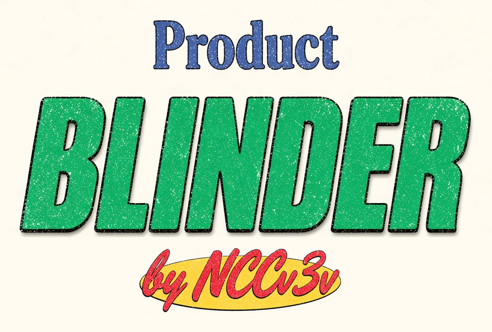
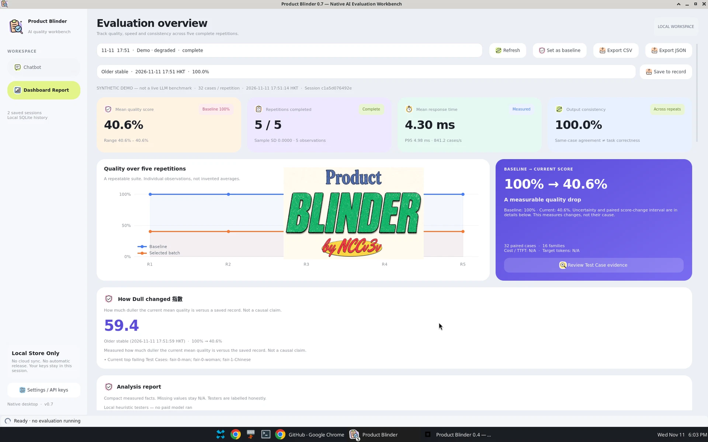
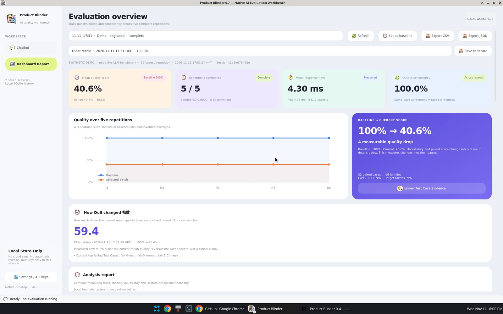
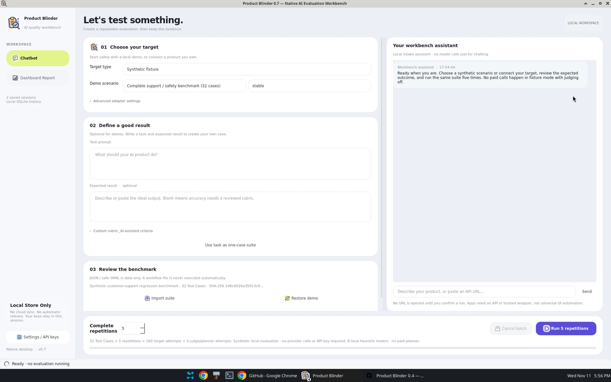
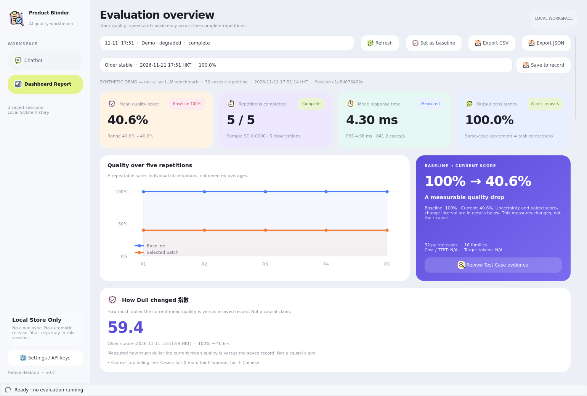

<div align="center">



<br/>

本地原生的 LLM 產品評測工作台
</br>
<em>A Local Native Workbench for LLM Product Evaluation</em>

<br/>

[](https://github.com/NCCv3v/Product-Blinder/stargazers)
[](https://github.com/NCCv3v/Product-Blinder/watchers)
[](https://github.com/NCCv3v/Product-Blinder/network)
[](https://www.python.org/)
[](./LICENSE)
[](https://doc.qt.io/qtforpython-6/)

[English](./README.md) | [中文文档](./README-ZH.md)

</div>

## ⚡ 項目概述

**Product Blinder** 是一套本地優先的原生工作台，用來評測 LLM 產品、管線與工作流程隨時間的品質變化。你指定評測對象、凍結測試套件，並對同一套件執行 **五次完整重複**。儀表板會顯示品質、速度、一致性與來源資訊，方便把目前的分析報告，和你先前儲存的紀錄做比較。

這是真正的 **Python 桌面程式**（PySide6 / Qt Widgets），不是網站、HTML 應用或 webview 包裝。不需要託管服務、帳號或遙測。API 金鑰只留在你的電腦上，放在獨立的設定面板。

> 你只需：描述或匯入產品、管線或測試套件，然後執行五次凍結重複評測</br>
> Product Blinder 會回傳：含分數、Test Case 軌跡、Find out problem 重點的 Dashboard Report；當你選取一筆已儲存紀錄時，還會計算 **How Dull changed 指數**

### 適用場景

- **捕捉品質回歸**：比較舊的本機紀錄與目前的分析報告
- **重複同一凍結套件五次**，而不是只看單一次「幸運」的結果
- **評測資料留在本機**：SQLite 歷史、由使用者主動觸發的 **Save to record**，不必註冊雲端帳號

測得的分數變化，並不能證明供應商抽走算力，或讓舊模型「變笨」。合成示範會清楚標示，也不是線上模型基準測試。

## 📸 系統截圖

以下為 Product Blinder **0.7** 原生桌面程式的實際畫面（合成示範，已標示）。

<div align="center">
<table>
<tr>
<td></td>
<td></td>
</tr>
<tr>
<td></td>
<td></td>
</tr>
</table>
</div>

## 🔄 工作流程

1. **匯入與描述**：在 **Chatbot** 分頁選擇內建套件，或描述任務、URL、程式、管線或工作流程，並可附上預期結果（或由 AI 提議、且明確標為暫定的評分規準）
2. **執行**：對同一凍結套件、同一評測對象，啟動五次完整重複
3. **報告**：開啟 **Dashboard Report**，查看每次重複的分數、速度、圖表、Test Case 脈絡，以及精簡的 **Find out problem** 列表
4. **Save to record**：將命名快照存進本機 SQLite（不含 API 金鑰）；儲存須由使用者主動觸發
5. **比較**：選取一筆已儲存紀錄，計算相對於目前分析報告的 **How Dull changed 指數**

## 🚀 快速開始

### 一、源碼安裝（建議）

#### 前置要求

| 工具 | 版本 | 說明 | 檢查方式 |
|------|------|------|----------|
| **Python** | 3.11+ | CLI 與原生介面的執行環境 | `python3 --version` |
| **桌面環境** | 具備 Qt／系統函式庫的 Linux | 圖形介面需要；CLI 可單獨使用 | — |

本地驗證環境為 Linux x86-64 / Python 3.13.5。

```bash
git clone https://github.com/NCCv3v/Product-Blinder.git
cd Product-Blinder
python3 -m venv .venv
source .venv/bin/activate
pip install -e '.[desktop,dev]'
product-blinder-desktop
```

這會開啟原生視窗，沒有網址。預設資料庫：`~/.local/share/product-blinder/product-blinder.sqlite`。也可用 `product-blinder-desktop --db /path/to/history.sqlite` 指定路徑。

其他啟動方式：`./scripts/product-blinder-desktop`、`python -m product_blinder.desktop`，或 `product-blinder ui`。

#### 安全的第一次試用（不需 API 金鑰）

在 Chatbot 中保持 **Adapter = Synthetic fixture**、停用真實 judge、**repetitions = 5**。在 **Synthetic version** 選擇 `stable` 或 `degraded`。內建套件包括：

1. **Complete support / safety benchmark（32 個案例）**
2. **Evidence-based support / RAG（12 個案例）**
3. **Receipt JSON extraction（12 個案例）**
4. **Robustness / fairness / injection（24 個案例）**

這些是確定性的 fixture，不是隱藏的 LLM 呼叫，用來驗證評測架構並安全地測試圖形介面。

### 二、僅使用 CLI

```bash
pip install -e .
product-blinder --db data/new-five-demo.sqlite demo-five --out reports/v0.7/demo-five
product-blinder-desktop --db data/new-five-demo.sqlite
```

`demo-five` 會建立兩批、各五次重複（共十次底層執行），並拒絕覆用非空資料庫。結束代碼：**0** 穩定／改善或示範成功；**2** 回歸；**3** 資料不足；**1** 設定或執行失敗。

### 三、Docker（CLI 引擎，不是瀏覽器介面）

```bash
docker compose build
docker compose run --rm product-blinder --db /app/data/new-demo.sqlite demo-five --out /app/data/demo
```

不會開放網頁埠或 HTML 前端。原生圖形介面應在主機上執行。原開發環境沒有 Docker，因此不宣稱已完成本地容器驗證。

## ✨ 功能特色

- **只有兩個主分頁**：Chatbot 與 Dashboard Report；金鑰放在 Settings
- **五次重複批次**：同一凍結套件，顯示每次的分數、來源、速度與一致性
- **How Dull changed 指數**：用目前報告對照一筆本機儲存的紀錄

```
index = 100 × max(0, S_old − S_now) / max(S_old, 1e-9)
```

分數為 `[0, 1]` 的平均品質。缺少分數或套件不匹配時顯示 **N/A**（不會憑空填數）。品質不變或提升時指數為 `0`；提升時仍會顯示 Record → Current 百分比，且不會標成變差。例如 **100% → 40.6%** 會得到 **59.4**。

- **Find out problem**：以精簡表格列出失敗的 Test Case、嚴重程度、檢查項與證據
- **可選的 LLM judge／規劃器**：相容 OpenAI 介面、需選擇加入並有預算上限；預設示範使用本機啟發式 testers
- **Local Store Only**：歷史與紀錄只存在本機 SQLite
- **開場畫面**：緊湊字標 — Product / BLINDER / by NCCv3v
- 權杖數、成本與 TTFT 只在真正取得時顯示，否則為 **N/A**

## 🧪 指標與比較

每次重複可顯示綜合品質、耗時、目標延遲（平均 / P50 / P95）、吞吐量、成功／錯誤／逾時率、準確度、有據性、指令遵循、有效性、穩健性、公平性、注入／安全、可靠度、重複一致性與分數變異，以及來源資訊。缺漏資料保持 **N/A**。

跨批次比較需要完整批次，且重複次數、套件 SHA-256 與 judge／執行設定一致。每個案例先對重複取平均，再用種子固定的 **2,000 次成對家族聚類 bootstrap** 估計分數變化的 95% 區間。五次重複**不會**把 32 個案例變成 160 個獨立任務。

預設邊際 ±0.05：區間完全低於 −邊際為 `regression`；完全高於 +邊際為 `improved`；完全落在邊際內為 `stable`；否則為 `insufficient-data`。這是測試分數的比較，不是通用智力排名，也不是對供應商算力的因果主張。

## 🔌 真實評測對象

支援 HTTP JSON 端點，以及明確信任的程式包裝器。只描述或貼上 URL 並不會立刻抓取或執行，直到你選擇 adapter 並開始執行。程式需要 `--allow-exec` 與同意，而且是**受信任程式碼，並非沙盒**。不要執行未經審閱的上傳檔。請在環境變數或 Settings 設定金鑰，不要寫進會被提交的檔案。

```bash
# 請在環境變數設定 PB_TARGET_API_KEY 與 PB_JUDGE_API_KEY，不要放在命令列參數。
product-blinder run --suite my-reviewed-suite.yaml --target examples/http-target.json \
  --config examples/live-config.json --repetitions 5 --consent-paid --out reports/live
```

套件 YAML、HTTP 與程式包裝範例見 `examples/`。套件匯入只接受資料（不含可執行的 YAML 標籤）。

## 🏗️ 架構與開發

`desktop` 原生元件 + QThread → `batches` 凍結重複工作階段 → `runner` → `adapters` → `evaluators`／可選 `judge` → `store`（SQLite）→ `comparison` → `batch_reports`。

```bash
pip install -e '.[desktop,dev,build]'
QT_QPA_PLATFORM=offscreen pytest -q
ruff check src tests
QT_QPA_PLATFORM=offscreen product-blinder-desktop --smoke --smoke-out native-smoke.json
```

測試使用合成 fixture 與模擬 HTTP，不會產生線上 API 費用。詳見 `CONTRIBUTING.md`、`DESIGN.md` 與 `ICONS.md`。

MIT 源碼／wheel 不內嵌 Qt。雖然提供 Linux 打包腳本（`scripts/build-linux.sh`），但在主機無法完成建置時，並不附帶獨立執行檔。

## 📈 項目統計

[](https://www.star-history.com/#NCCv3v/Product-Blinder&Date)

## 📄 授權

[MIT](./LICENSE) © 2026 [NCCv3v](https://github.com/NCCv3v)
