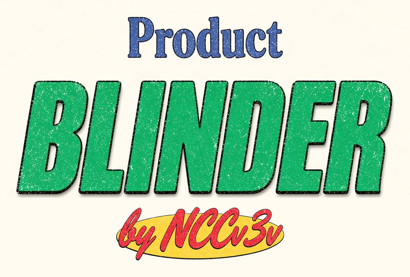
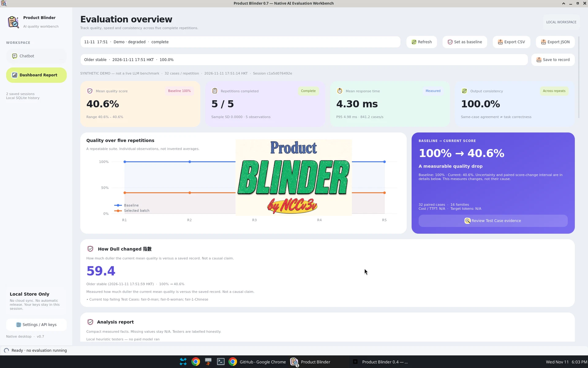
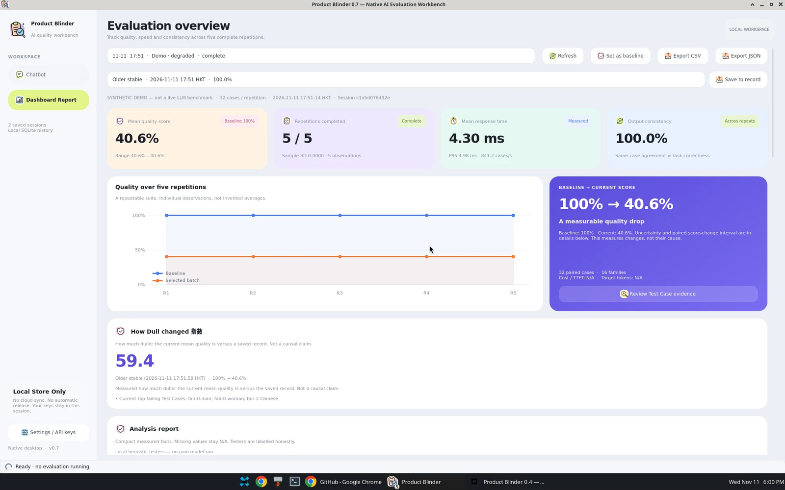
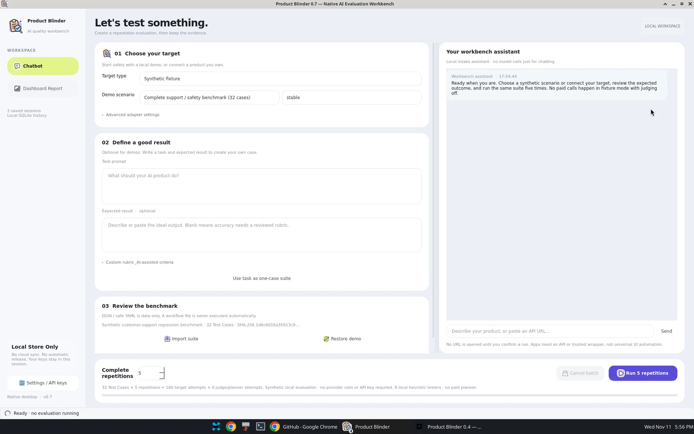
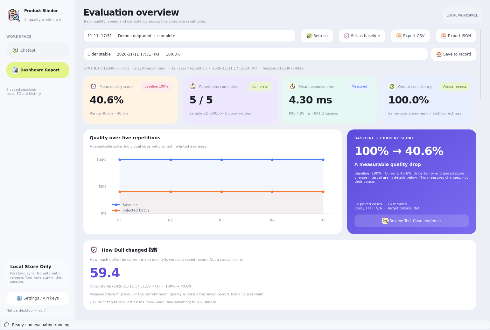

<div align="center">



<br/>

本地原生的 LLM 產品評測工作台
</br>
<em>A Local Native Workbench for LLM Product Evaluation</em>

<br/>

[](https://github.com/NCCv3v/Product-Blinder/stargazers)
[](https://github.com/NCCv3v/Product-Blinder/watchers)
[](https://github.com/NCCv3v/Product-Blinder/network)
[](https://www.python.org/)
[](./LICENSE)
[](https://doc.qt.io/qtforpython-6/)

[English](./README.md) | [中文文档](./README-ZH.md)

</div>

## ⚡ Overview

**Product Blinder** is a local-first native workbench for evaluating LLM products, pipelines and workflows over time. You point it at a target, freeze a test suite, and run the same suite **five complete repetitions**. The dashboard then shows quality, speed, consistency and provenance — so you can see whether a later version looks worse than a record you saved earlier.

It is a **real Python desktop program** (PySide6 / Qt Widgets), not a website, HTML app or webview wrapper. There is no hosted service, account or telemetry. API keys stay on your machine, in a separate Settings panel.

> You only need to: describe or import a product, pipeline or suite, then run five frozen repetitions</br>
> Product Blinder will return: a Dashboard Report with scores, Test Case traces, Find out problem highlights, and — when you pick a saved record — a **How Dull changed 指數**

### What it is for

- **Catch quality regression** between an older saved record and the current analysis report
- **Repeat the same frozen suite** five times, instead of relying on a single lucky run
- **Keep evaluation local**: SQLite history, user-initiated **Save to record**, no required cloud account

A measured score change is not a claim that a vendor diverted compute or made an older model “dumber.” Synthetic demos are labelled as such and are not live model benchmarks.

## 📸 Screenshots

Live captures from Product Blinder **0.7** running as a native desktop app (synthetic demo, clearly labelled).

<div align="center">
<table>
<tr>
<td></td>
<td></td>
</tr>
<tr>
<td></td>
<td></td>
</tr>
</table>
</div>

## 🔄 Workflow

1. **Intake**: In the **Chatbot** tab, select a built-in suite or describe a task, URL, program, pipeline or workflow, with optional expected results (or an AI-proposed rubric, clearly marked as provisional)
2. **Run**: Start five complete repetitions of the same frozen suite against the same target
3. **Report**: Open **Dashboard Report** for per-repetition scores, speed, charts, Test Case context and a short **Find out problem** list
4. **Save to record**: Store a named snapshot in the local SQLite file on this computer only (no API keys); saving is user-initiated
5. **Compare**: Pick a saved record to compute **How Dull changed 指數** against the current analysis report

## 🚀 Quick Start

### Option 1: Source install (recommended)

#### Prerequisites

| Tool | Version | Description | Check |
|------|---------|-------------|-------|
| **Python** | 3.11+ | Runtime for CLI and the native UI | `python3 --version` |
| **Desktop environment** | Linux with Qt/system libraries | Required for the GUI (CLI works without it) | — |

Local verification used Linux x86-64 / Python 3.13.5.

```bash
git clone https://github.com/NCCv3v/Product-Blinder.git
cd Product-Blinder
python3 -m venv .venv
source .venv/bin/activate
pip install -e '.[desktop,dev]'
product-blinder-desktop
```

This opens a native window; there is no URL. Default database: `~/.local/share/product-blinder/product-blinder.sqlite`. Use another path with `product-blinder-desktop --db /path/to/history.sqlite`.

Other launchers: `./scripts/product-blinder-desktop`, `python -m product_blinder.desktop`, or `product-blinder ui`.

#### Safe first run (no API key)

In Chatbot, keep **Adapter = Synthetic fixture**, real judge disabled, **repetitions = 5**. Select `stable` or `degraded` under **Synthetic version**. Built-in suites include:

1. **Complete support / safety benchmark (32 cases)**
2. **Evidence-based support / RAG (12 cases)**
3. **Receipt JSON extraction (12 cases)**
4. **Robustness / fairness / injection (24 cases)**

These are deterministic fixtures, not hidden LLM calls. They verify the harness and make the GUI safely testable.

### Option 2: CLI only

```bash
pip install -e .
product-blinder --db data/new-five-demo.sqlite demo-five --out reports/v0.7/demo-five
product-blinder-desktop --db data/new-five-demo.sqlite
```

`demo-five` creates two batches of five repetitions each (ten underlying runs) and refuses to reuse a nonempty database. Exit statuses: **0** stable/improved or demo success; **2** regression; **3** insufficient data; **1** setup/execution failure.

### Option 3: Docker (CLI engine, not a browser UI)

```bash
docker compose build
docker compose run --rm product-blinder --db /app/data/new-demo.sqlite demo-five --out /app/data/demo
```

No web ports or HTML frontend are exposed. The native GUI is meant to run on the host. Docker was not available in the original build environment, so no local container verification is claimed.

## ✨ Features

- **Exactly two main tabs**: Chatbot and Dashboard Report; keys live in Settings
- **Five-repetition batches** of a frozen suite, with per-run score, provenance, speed and consistency
- **How Dull changed 指數**: compares the current report with a saved local record

```
index = 100 × max(0, S_old − S_now) / max(S_old, 1e-9)
```

Scores are mean quality in `[0, 1]`. Missing scores or unmatched suites show **N/A** (nothing is invented). Unchanged or improved quality yields `0`; improvements also show Record → Current percentages and are not labelled as duller. Example: **100% → 40.6%** gives **59.4**.

- **Find out problem**: short table of failing Test Cases, severity, checks and evidence
- **Optional LLM-as-judge / planner**: OpenAI-compatible, opt-in, budgeted; default demos use local heuristic testers
- **Local Store Only**: history and records stay in the local SQLite file
- **Opening splash**: compact typography wordmark — Product / BLINDER / by NCCv3v
- Tokens, cost and TTFT are shown only when genuinely known; otherwise **N/A**

## 🧪 Metrics and comparison

Every repetition can show composite quality, duration, target latency (mean / P50 / P95), throughput, success / error / timeout rates, accuracy, groundedness, instruction adherence, validity, robustness, fairness, injection/safety, reliability, repeat consistency and score variation, plus source/provenance. Missing data stays **N/A**.

Cross-batch comparisons require complete batches with matching repetition count, suite SHA-256 and judge/run configuration. Each case is averaged across repetitions, then a seeded **2,000-resample paired family-cluster bootstrap** estimates the 95% interval of case score change. Five repetitions do **not** turn 32 cases into 160 independent tasks.

Default margin ±0.05: `regression` if the interval is entirely below −margin; `improved` above +margin; `stable` if entirely inside the margin; otherwise `insufficient-data`. This is a test-score comparison, not a universal intelligence ranking or a causal vendor-compute claim.

## 🔌 Real targets

HTTP JSON endpoints and explicitly trusted program wrappers are supported. Describing or pasting a URL does not fetch or execute it until you choose an adapter and start a run. Programs need `--allow-exec` and consent; they are **trusted code, not sandboxed**. Do not execute unreviewed uploads. Set keys in the environment or Settings, never in committed files.

```bash
# Set PB_TARGET_API_KEY and PB_JUDGE_API_KEY in your environment, not CLI arguments.
product-blinder run --suite my-reviewed-suite.yaml --target examples/http-target.json \
  --config examples/live-config.json --repetitions 5 --consent-paid --out reports/live
```

See `examples/` for suite YAML, HTTP and program-wrapper samples. Suite imports are data-only (no executable YAML tags).

## 🏗️ Architecture and development

`desktop` native widgets + QThread → `batches` frozen repeated sessions → `runner` → `adapters` → `evaluators` / optional `judge` → `store` (SQLite) → `comparison` → `batch_reports`.

```bash
pip install -e '.[desktop,dev,build]'
QT_QPA_PLATFORM=offscreen pytest -q
ruff check src tests
QT_QPA_PLATFORM=offscreen product-blinder-desktop --smoke --smoke-out native-smoke.json
```

Tests use synthetic fixtures and mocked HTTP; no live API billing. See `CONTRIBUTING.md`, `DESIGN.md` and `ICONS.md`.

The MIT source/wheel does not embed Qt. A standalone Linux bundle script exists (`scripts/build-linux.sh`), but a packaged binary is not supplied when the build cannot be completed on the host.

## 📄 Acknowledgments

Product Blinder is original MIT-licensed source. No reference repository was cloned and no upstream code was incorporated. Read-only concept review (11 November 2026, HKT):

- [LangTest](https://github.com/PacificAI/langtest) (Apache-2.0)
- [DeepEval](https://github.com/confident-ai/deepeval) (Apache-2.0)
- [MiroFish](https://github.com/666ghj/MiroFish) (AGPL-3.0) — conceptual specialist/report roles only

These projects are not runtime dependencies. See `ATTRIBUTION.md` for reviewed links. Qt/PySide is a separately licensed runtime.

## 📈 Project Statistics

[](https://www.star-history.com/#NCCv3v/Product-Blinder&Date)

## 📄 License

[MIT](./LICENSE) © 2026 [NCCv3v](https://github.com/NCCv3v)
